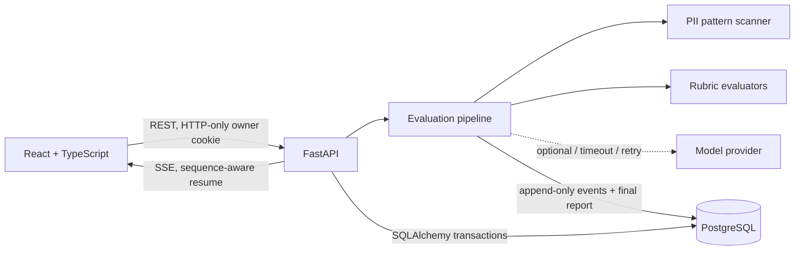

# AI Quality Lab

> **Evaluate AI responses. Understand every decision.**

AI Quality Lab is a full-stack, explainable evaluation workspace for reviewing an AI response against a user-defined weighted rubric. It performs real deterministic and labeled heuristic checks, detects potential privacy exposure, persists the result, and visualizes the actual server execution as it happens.

This project was built for the **Handshake Replit Internship Challenge: Build an App that Shows Its Work**.

## Why it exists

Reviewing generated responses is repetitive: reviewers look for missing requirements, weak structure, risky personal data, and rubric violations, then manually explain the result. AI Quality Lab automates the repeatable parts and gives the reviewer an audit trail instead of an opaque score.

It deliberately does **not** claim that lexical heuristics prove factual accuracy or that a score guarantees a hallucination-free answer. Every criterion is identified as deterministic, heuristic, or model-assisted.

## Features

- Real prompt/response/reference input and a 1–12 criterion weighted rubric
- Deterministic phrase, length, structure, and PII-pattern checks
- Labeled instruction-following and reference-overlap heuristics
- Optional OpenAI-compatible model provider with a privacy gate
- Strict provider timeout, bounded exponential-backoff retry, and real deterministic fallback
- Eight-stage live React Flow diagram driven by persisted backend SSE events
- Authentic server timestamps and monotonic execution durations
- Stage inspector with safely summarized metadata, errors, retries, and recovery
- Persistent evaluation history and browser-session ownership isolation
- Replay with Play, Pause, Restart, and 0.5×–4× visualization speed
- JSON and Markdown report exports
- Idempotency protection, validation, rate limiting, redacted errors, and security headers
- Development-only controlled failure testing
- Responsive light/dark SaaS interface

## Architecture



The production deployment is one process: Vite builds the React client into `dist/`, and FastAPI serves those assets plus `/api`. Replit provides PostgreSQL through `DATABASE_URL`. Local development falls back to SQLite; deployed persistence must use the managed PostgreSQL database.

The pipeline stages are:

1. Receive and validate user input
2. Save evaluation request
3. Analyze submitted response
4. Check potential PII exposure
5. Evaluate rubric criteria
6. Execute optional AI-assisted evaluation
7. Aggregate evaluation results
8. Store and present the final report

See [docs/ARCHITECTURE.md](docs/ARCHITECTURE.md) and [docs/DATABASE_SCHEMA.md](docs/DATABASE_SCHEMA.md) for the detailed design.

## Technology

- **Frontend:** React 19, TypeScript, Vite, React Router, React Flow, Lucide
- **Backend:** Python 3.10+, FastAPI, Pydantic, SQLAlchemy
- **Database:** PostgreSQL in Replit; SQLite local fallback
- **Streaming:** Server-Sent Events over a persistent event log
- **Tests:** pytest, FastAPI TestClient, Vitest, Testing Library

## Local setup

Prerequisites: Node.js 20+ and Python 3.10+.

```bash
python -m venv .venv
# Windows: .venv\Scripts\activate
# macOS/Linux: source .venv/bin/activate
pip install -r requirements.txt
npm ci
cp .env.example .env
npm run build
python -m uvicorn app.main:app --host 127.0.0.1 --port 5000
```

Open `http://127.0.0.1:5000`. For frontend hot reload, run `npm run dev` in a second terminal; Vite proxies `/api` to port 5000.

## Environment variables

| Variable | Required | Purpose |
|---|---:|---|
| `APP_ENV` | Yes in prod | `development` or `production`; controls secure cookies/docs |
| `DATABASE_URL` | Yes in prod | Replit PostgreSQL connection string |
| `SESSION_SECRET` | Yes in prod | Random secret used to HMAC anonymous owner tokens |
| `OPENAI_API_KEY` | No | Enables the optional OpenAI-compatible provider |
| `OPENAI_BASE_URL` | No | Provider API base, defaults to OpenAI |
| `OPENAI_MODEL` | No | Provider model identifier |
| `PROVIDER_TIMEOUT_SECONDS` | No | Strict provider request timeout |
| `PROVIDER_MAX_ATTEMPTS` | No | Bounded provider attempts; recommended 2 |
| `ALLOW_EXTERNAL_AI_WITH_PII` | No | Defaults false; keep false for the public demo |
| `ENABLE_FAILURE_TESTING` | No | Development-only controlled provider/database failure modes |

Never add `.env`, API keys, or database URLs to Git.

## Testing

```bash
python -m pytest -q
npm run typecheck
npm run test
npm run build
npm audit
```

The backend suite verifies valid/invalid requests, durable restoration, ordered real events, event/run isolation, authentic durations, idempotency, redaction, weighted scoring, retry/fallback, and database health. The frontend suite verifies replay graph reconstruction; the TypeScript build protects component/API contracts.

See [docs/TEST_REPORT.md](docs/TEST_REPORT.md) for the recorded release verification.

## How live execution works

The server creates the run and initial pending events transactionally, then executes each stage. A stage writes `running` and a terminal status with its measured duration. Event messages contain counts and categories—not raw prompt text or PII matches.

The browser first loads stored events, then opens an SSE stream using the last known sequence. The stream reads newer events from the database in strict order. A disconnect does not cancel work; reload restores the run and reconnects after the latest sequence.

## How replay works

Replay loads the original persisted event list and progressively reveals those events in sequence. Play, Pause, Restart, and speed affect only presentation. Original timestamps and `duration_ms` remain unchanged and visible in the stage inspector.

## Failure handling

- Invalid input returns field-level 422 feedback and the React form stays mounted with its values.
- Duplicate submissions return the existing run under the same owner/idempotency key.
- Provider errors are retried with bounded exponential backoff, then visibly recover to deterministic checks.
- PII findings block external model calls by default.
- Database operations roll back on failure; event writes retry transient operational errors.
- A failed final write never displays a successful report, while the original persisted submission remains reviewable.
- Browser disconnects recover from the stored event sequence.

## Replit publishing

The checked-in `.replit` uses:

- Build: `pip install -r requirements.txt && npm ci && npm run build`
- Run: `python -m uvicorn app.main:app --host 0.0.0.0 --port 5000`
- Port mapping: local `5000` → external `80`

Before publishing, add the Replit managed database, set a strong `SESSION_SECRET`, choose Autoscale, confirm the production database option, and verify `/api/health` plus a real evaluation on the public URL. Full instructions are in [docs/DEPLOYMENT.md](docs/DEPLOYMENT.md).

Publishing has **not** been claimed complete until a live URL is manually verified.

## Privacy notice

The server stores prompts, candidate responses, optional references, rubric definitions, reports, and redacted execution metadata for the owning browser session. Clearing that cookie loses access to anonymous records. Pattern detection can produce false positives and is not a substitute for a privacy review. External model processing is optional, redacted by default, and blocked when potential PII exists unless the server operator explicitly changes the policy.

## Limitations

- Anonymous browser ownership is a smooth public-demo access control, not recoverable account authentication.
- Per-process rate limits are not global across multiple autoscaled instances.
- SQLite is for local development only.
- Subjective criteria remain heuristic without an optional provider and are still judgments when a provider is used.
- Reference-term overlap does not verify truth.
- A durable worker queue would be appropriate for high-volume or long-running production workloads.

## Project documents

- [Product requirements](docs/PRD.md)
- [Architecture](docs/ARCHITECTURE.md)
- [Database schema](docs/DATABASE_SCHEMA.md)
- [Implementation plan](docs/IMPLEMENTATION_PLAN.md)
- [Handshake evidence map](docs/HANDSHAKE_REQUIREMENTS.md)
- [Deployment runbook](docs/DEPLOYMENT.md)
- [Test report](docs/TEST_REPORT.md)
- [Demo script](docs/DEMO_SCRIPT.md)
- [Submission copy](docs/SUBMISSION.md)

## Future improvements

Account sign-in and record recovery, reusable rubric libraries, team sharing, run comparisons, distributed rate limiting, a durable job queue, provider cost ledgers, and retrieval-backed factual verification.
