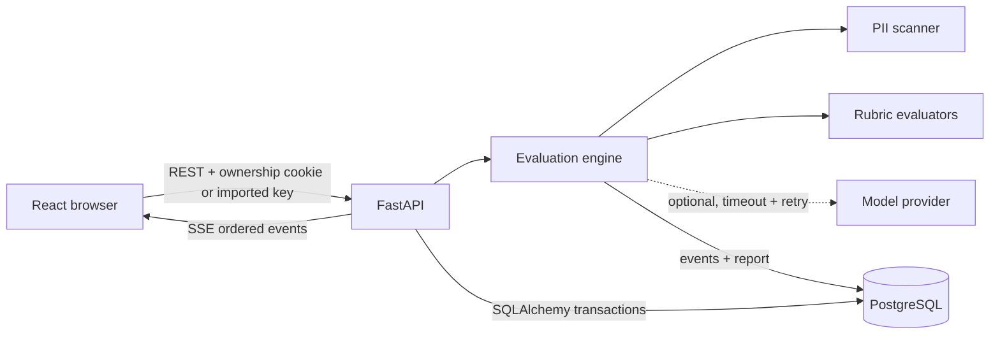

# Architecture Specification

## Decision summary

AI Quality Lab is a single deployable application: a Vite/React/TypeScript client is compiled into static assets and served by a FastAPI/Python API. SQLAlchemy targets PostgreSQL through `DATABASE_URL` in Replit and SQLite for local development. This keeps deployment simple while preserving a real frontend/backend/database boundary.



## Components

### React client

- React Router routes: Dashboard, New Evaluation, Live Run/Results, History, Architecture.
- TanStack Query owns server state and refresh behavior.
- `@xyflow/react` renders the live graph from real event state.
- `EventSource` consumes SSE; `after` query state and persisted event loading recover gaps.
- Replay is a pure client state machine over stored events. Visualization timing is scaled, but displayed timestamps and durations are immutable.

### FastAPI API

- Pydantic schemas provide request/response validation and size limits.
- Middleware assigns an opaque random owner token in a secure/same-site/HTTP-only cookie. An explicitly imported workspace key can establish the same owner on another trusted device.
- Routes always filter by the hash of the owner token.
- Submission inserts a run transactionally and starts evaluation in a server background task.
- SSE polls persisted events. PostgreSQL LISTEN/NOTIFY is intentionally avoided for portability; low-volume polling is reliable across reconnects and local SQLite.

### Evaluation engine

- A pipeline orchestrator executes eight named stages and measures durations with `time.perf_counter_ns()`.
- `EventRecorder` allocates a monotonically increasing sequence under the run transaction and writes safe metadata only.
- Deterministic evaluators implement phrase, structure, length, and privacy checks.
- Heuristic evaluators implement reference token overlap and instruction-cue coverage, clearly labeled.
- `ModelProvider` is an interface. The OpenAI-compatible implementation is optional, validates JSON output, uses a strict timeout, and retries transient errors. Provider exhaustion triggers a recorded `recovered` event and deterministic fallback.

### Persistence

- `evaluation_runs` stores the authorized submission and final report.
- `execution_events` stores an append-only, ordered execution log.
- Uniqueness on `(owner_hash, idempotency_key)` prevents duplicate execution.
- Uniqueness on `(run_id, sequence)` preserves ordering.
- JSON columns hold evolving rubric/report metadata; text content remains on the authorized run, never copied into event logs.

## API contracts

- `POST /api/evaluations` — create or return an idempotent run. Returns `202` for a new run and `200` for an existing key.
- `GET /api/evaluations` — authorized history with pagination.
- `GET /api/evaluations/{run_id}` — authorized run and report.
- `GET /api/evaluations/{run_id}/events` — complete authorized ordered event list.
- `GET /api/evaluations/{run_id}/stream?after=<sequence>` — SSE stream, heartbeats, terminal close.
- `GET /api/dashboard` — authorized aggregates/recent runs.
- `GET /api/health` — liveness/readiness and database connectivity without secrets.
- `GET /api/meta` — capability and limit metadata.
- `GET /api/workspace-access` — explicitly reveal the current opaque access key with `Cache-Control: no-store`.

## Execution event schema

```json
{
  "id": "uuid",
  "run_id": "uuid",
  "sequence": 12,
  "stage_id": "privacy_scan",
  "event_type": "stage.completed",
  "status": "completed",
  "timestamp": "2026-11-12T12:00:00.000Z",
  "duration_ms": 4.382,
  "message": "Detected 1 potential PII category",
  "metadata": {"finding_count": 1, "categories": ["email"]},
  "error": null
}
```

Metadata allowlists are stage-specific. Raw submitted text, raw PII matches, cookies, provider keys, and database connection values are forbidden.

## Pipeline state model

`pending → running → completed | skipped | failed`

Provider work may additionally use `running → retrying → recovered → completed`; `recovered` means the recorded fallback truly executed. The overall run becomes `completed`, `completed_with_warnings`, or `failed`. A terminal pipeline error is persisted on the run and sent as an event where database access remains available.

## Failure behavior

- **Invalid input:** FastAPI returns structured 422 errors before creating work. The client keeps local form state.
- **Duplicate request:** the owner/idempotency unique constraint returns the original run.
- **Provider timeout:** two bounded attempts with exponential backoff; a recovered event names deterministic fallback and reduced capability.
- **Database transient failure:** bounded transaction retry; rollback on every failed attempt. The API never reports a successful write it did not commit.
- **Browser disconnect:** no server work depends on the socket. The client loads stored state/events and reconnects from the last sequence.
- **Server restart:** accepted run data is retained. In this challenge scope, a run left `queued/running` is marked recoverable at startup and can be reprocessed idempotently; completed stages remain in the audit log.

## Security and privacy

- Owner tokens contain 256 bits of randomness; only an HMAC hash is stored.
- Cookies are HTTP-only, SameSite=Lax, and Secure in production.
- Access keys are revealed only through the explicit workspace-access UI; imported values are format-validated and sent only to same-origin API requests.
- ORM queries are parameterized and always ownership-scoped.
- Input length and rubric count are bounded.
- A token-bucket-style per-client limiter protects submission and read endpoints (per-process demo control).
- Logs use request/run IDs and sanitized errors, not prompt/response content.
- Model use defaults off. PII blocks outbound model calls unless an explicit deployment setting permits redacted input.
- CSP and common security headers are set centrally.

## Deployment architecture

Build command: `npm ci && npm run build && pip install -r requirements.txt`

Run command: `uvicorn app.main:app --host 0.0.0.0 --port ${PORT:-5000}`

The production image needs `DATABASE_URL`, `SESSION_SECRET`, and optional provider settings. Database migrations run with Alembic before serving in mature production; this challenge also supports guarded `create_all` for a zero-setup demo.

## Tradeoffs

- Polling SSE storage is less immediate than an in-memory broker but survives refresh/restart and avoids new infrastructure.
- Opaque workspace keys add simple cross-device recovery, but have no user identity, expiry, or revocation. OAuth or magic-link authentication remains the first production evolution.
- A single process can run evaluations safely for demo traffic. A durable task queue is recommended for high volume or long model calls.
